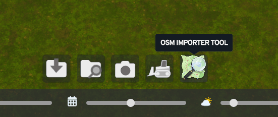
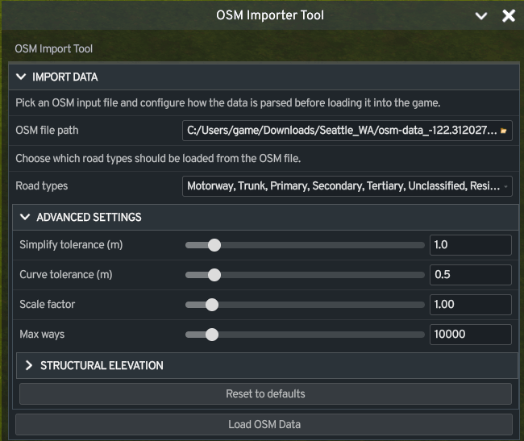
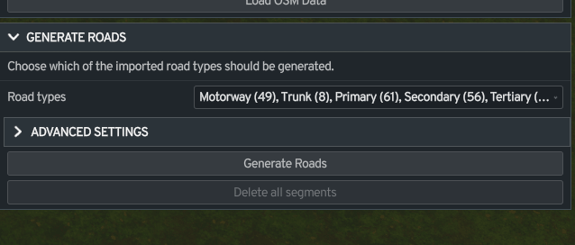

# cs2-osm-importer

A **Cities: Skylines 2** mod that imports real-world road network data from **[OpenStreetMap](https://wiki.openstreetmap.org/wiki/About_OpenStreetMap) (OSM)** XML files and procedurally generates the corresponding road networks inside the game world.

#### Dependencies
* Unified Icon Library

## Usage
### 1. Download OSM Data
OSM data can be downloaded from a variety of sources. \
I recommend [terraining.ateliernonta.com](https://terraining.ateliernonta.com) (see the [GitHub repo](https://github.com/nonta1234/terraining-heightmap-generator#readme) for details).

> [!NOTE]
> It is recommended that you also download heightmap data at the website [terraining.ateliernonta.com](https://terraining.ateliernonta.com).
> 
> [Learn more about heightmaps in Cities Skylines II](https://cs2.paradoxwikis.com/Map_Creation#Heightmaps)

### 2. Launch editor
Open the in-game editor.


### 3. Open OSM Importer Tool
Select **OSM Importer Tool** in the editor to open the mod tool panel.



### 4. Import the OSM Data
Use **OSM file path** to pick your `.osm` file. Adjust options if needed, then click **Load OSM Data** and **Continue**.

To prioritize important roads, optionally set **Priority roads file** to a `.txt` file with one road name per line. Matching roads are imported first, but only when their road type is selected in the import filter.

> [!NOTE]
> Loading may freeze the game for a few seconds while the file is parse.

### 5. Generate roads
Choose which loaded road types to generate, then click **Generate Roads**.

> [!NOTE]
> Generation can take some time, especially for dense road networks.

|  |  |
|:-------------------------------------------------------------------------------------------:|:----------------------------------------------------------------------------------------------:|
|                                       1: Import Data                                        |                                       2: Generate Roads                                        |

## Known issues

- **Some parking lots are not connected to a street.** A small share of imported surface parking lots (under 3% in the
  test areas) are built with their pavement and stalls, but cars cannot reach them. Known causes:
  - Another network lies between the lot and the street at the entrance point, such as a separately mapped bike path
    (cycleway) or tram line. The lot's entrance links to that network instead of the street.
  - The entrance is aimed at a tight bend in the street (suspected, not confirmed).
- **Roads can overlap railways.** In places where an OSM road crosses or runs beside a rail line (several Seattle light
  rail and tram corridors), the built road lies on top of the tracks instead of crossing them cleanly, and CS2 then
  draws a pile of overlapping crosswalks there. Cause not yet investigated.
- **Lakes only fill where the heightmap has a lake bed below the shore.** Lakes, ponds and reservoirs are filled with
  constant-level water sources at the height of the ground just outside their OSM outline. That needs the heightmap's
  lake bed to sit below that shore (it does on Green Lake). A lake whose bed is at the same height as its shore is
  skipped, with a log line. Water bodies under 1000 m2 and rivers, streams and canals are not filled.
- **Set the heightmap and the sea level before generating.** The importer does not set the sea level; it reads the
  map's. A lake at or below it gets no water sources of its own: the sea fills it (in the Seattle heightmap, Lake
  Union, Portage Bay and the Ship Canal sit at 0 m together with Puget Sound, so they only have water once the sea
  level is set above 0). Pier decks and shore paths are placed at generation from the lake or sea level, whichever is
  higher, so changing the sea level afterwards leaves them too low or too high. The water takes a few minutes to rise
  after the sea level is set; when piers stand in the sea, Generate waits for it ("Waiting for the sea to rise") before
  building, because the game would otherwise put some pier nodes on the still-rising water and the piers would end up
  under it. The wait gives up after 10 minutes with a log warning.
- **Raised shore paths add node offsets.** Paths along a lake shore that the heightmap's lake bed reaches under are
  raised 1 m above the water. With a higher water level more of them are raised, and the connectivity scan reports
  more nodes the game moved a few meters ("offset"): on the Lake Union test area 186 instead of 157 with the sea level
  at 2 m instead of 0 m (overlapping and dead-end counts unchanged). Offsets are usually harmless, and the link to the
  raised points is suspected, not confirmed.
- **Lakes take a few minutes to fill.** The water rises slowly while the roads are built (filling a deep basin all at
  once sloshes over low spots of the shore), and the import finishes once the lakes are full. Deleting the generated
  network removes the water sources; the water already there drains away on its own.
- **Piers are walkways, and a few marina joints stay open.** `man_made=pier` lines become footways on a deck 1 m above
  the water. Pier areas get a walkway down their middle (their skeleton); shapes it cannot read are skipped, with a
  log line. Pier ends near a path or another pier are joined to it. A pier with no path within 35 m (a swimming raft
  out in the lake) is left out. A dock mapped twice (a line and an area, or two lines within 3.5 m) is built once. On
  the Lake Union test area (about 400 piers), a few joints near piers still do not connect: two pier ends stop about
  3 m short of a bike path, and a few short dead-end stubs sit where an added shore connector meets a sloped bank.
  Where the lake has no water (see above), the piers stand over a dry bed.

## How it works (for developers)

The mod follows CS2's **ECS pattern** with a custom `OsmImportDefinition` component and two systems:

- **`OsmImportSystem`** (extends `GameSystemBase`) — handles the full import pipeline via a **state machine** (`WorkPhase`: `Idle` → `LoadData` → `QueueDefinitions` → `WaitForGameApply` → `DeleteRoads`). Road segment generation is **frame-budgeted** (128 segments per frame) to avoid blocking the game loop.
- **`OsmImporterUISystem`** (extends `UISystemBase`) — bridges the in-game UI to the import system.

The UI registers React components into the game UI and communicates with the C# backend through `ValueBinding`/`TriggerBinding` data bindings.

### Version bumping

Use `bump-version.ps1` to update both the mod publish version and `ui/mod.json` in one step:

```powershell
./bump-version.ps1 patch
./bump-version.ps1 minor
./bump-version.ps1 major
```

If you omit the argument, it defaults to `patch`.

## References

- [Cities Skylines II Modding Toolchain](https://cs2.paradoxwikis.com/Modding_Toolchain) - helpful for getting modding development environment
- [CS2 Modding documentation](https://cs2.paradoxwikis.com/Modding)
- This project was based off of the [Cities Skylines OSM Import mod](https://steamcommunity.com/sharedfiles/filedetails/?id=1957515502).
- Related tools/mods:
  - [cs2-minneapolis-osm-toolkit](https://github.com/Osyanne/cs2-minneapolis-osm-toolkit): Real-world GIS data from OpenStreetMap
- Mod [Find It](https://mods.paradoxplaza.com/mods/77240/Windows) was vital in the development of this project. It is incredibly useful for referencing prefabs


### Feedback
Report bugs, request features, or provide general feedback by creating an [issue on the Github repo](https://github.com/digiphreniac/cs2-osm-importer/issues). \
Please look at the existing issues before creating one to avoid creating duplicates.
